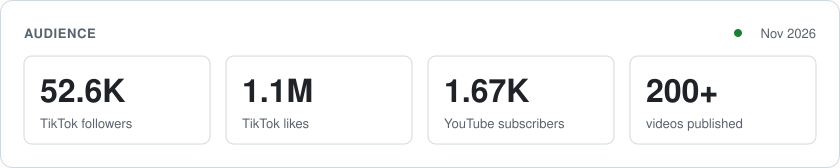

Videographer & developer. **52K+ followers on [TikTok](https://www.tiktok.com/@eddyjnge)**, 1.1M likes. I build the tools I wish I had on set.

Check out my [TikTok](https://www.tiktok.com/@eddyjnge) (new channel: [@eddy6018](https://www.tiktok.com/@eddy6018)), [Instagram](https://www.instagram.com/eddyjnge/) or [YouTube](https://www.youtube.com/@eddyjunge).

<picture>
  <source media="(prefers-color-scheme: dark)" srcset="assets/stats-dark.svg">
  
</picture>

## Current Projects

### Products

- **[Latitude](https://github.com/eddyjunge/Latitude)** — Room to grade. An Android camera app that records Apple Log footage, built for DaVinci Resolve

### Hackathons

Built with [Jonas](https://github.com/jonassneu):

- **[GestureLink](https://github.com/eddyjunge/GestureLink)** — Your hand is the mouse. An Android phone's camera tracks your gestures and controls a Windows PC. Winner of a 3 h Cursor hackathon (Kotlin)
- **[Eastbound or Westbound?](https://github.com/eddyjunge/fraalliance-hackmeck)** — Forecasts Frankfurt Airport's operating direction 48 h ahead. FraAlliance challenge, AI Week Frankfurt 2026

### Client Work

- **Inner District** — Web presence and shop for a fashion brand (TypeScript)
- **Jade & More** — Online shop with Convex, Stripe and Cloudflare

### Everything Else

- **HSK 6 Trainer** — Vocabulary trainer for the hardest Chinese proficiency level
- **Resolve Caption Cleaner** — Fixes auto-generated subtitles in DaVinci Resolve

**Stack:** Kotlin · TypeScript · JavaScript · DaVinci Resolve · way too many Claude tabs
